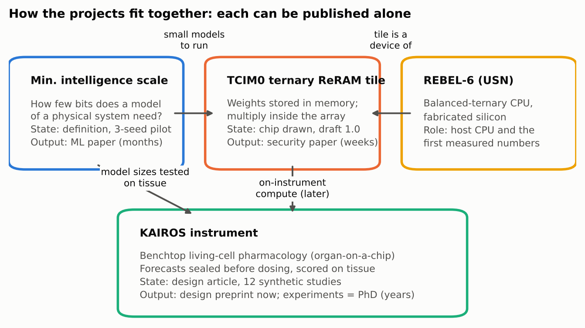
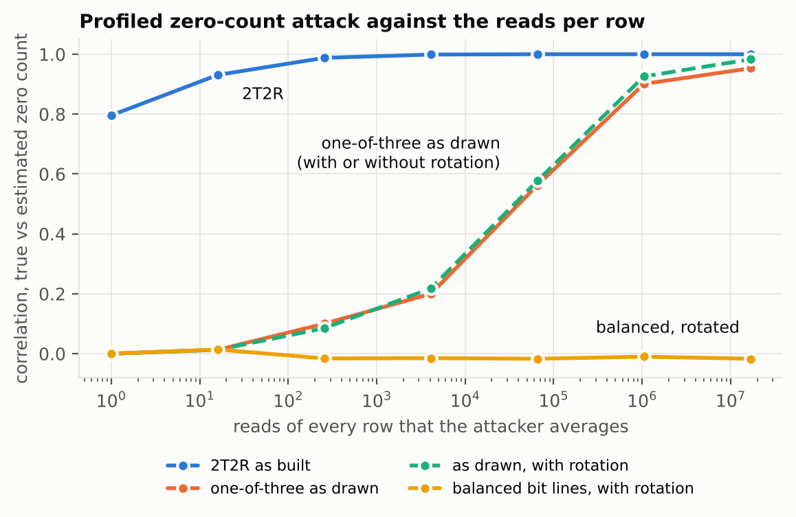
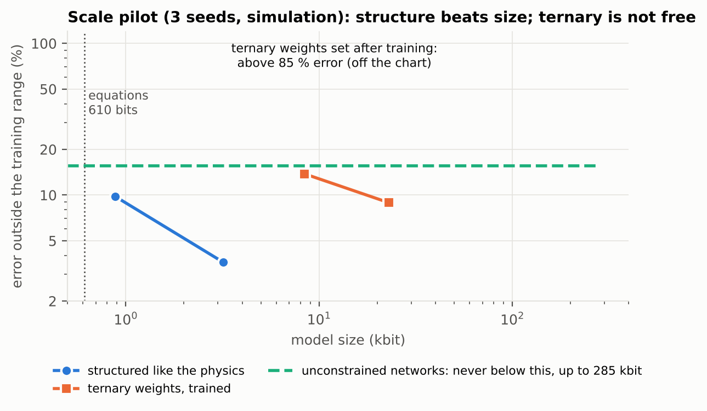
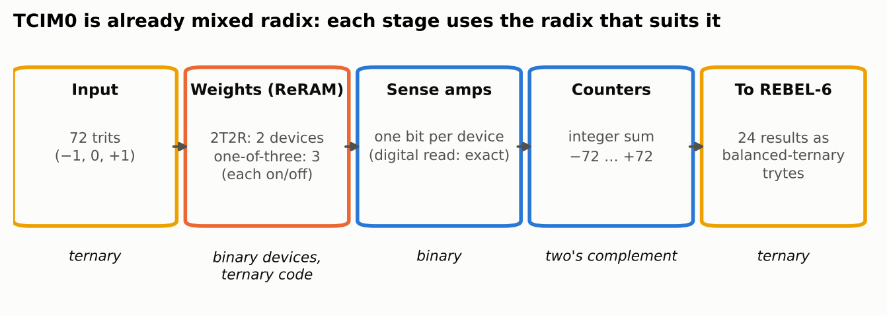
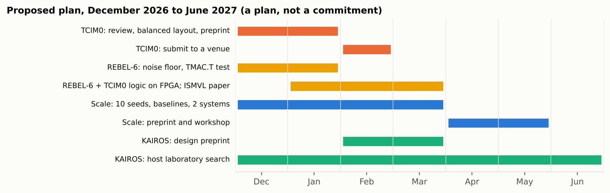
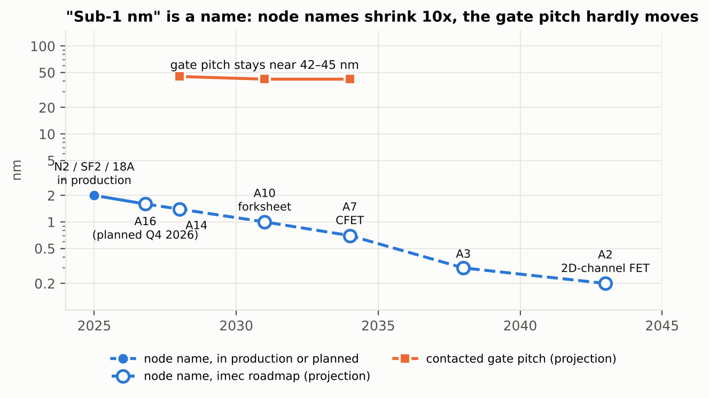
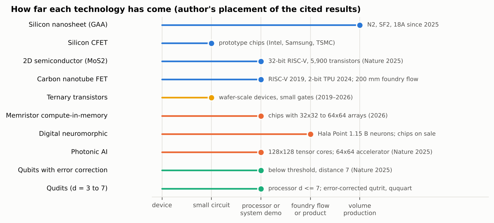

# Brief for the meeting with Steven Bos (USN), week of 16 November 2026

Prepared 14 November 2026. Numbers are from `results/` in the repository `Reram-ternary`; leakage numbers are from
`results/security/v1/` and are statements about a model, not about silicon.

## 1. What to say in the first two minutes

- TCIM0 is a 72 × 24 ternary ReRAM compute-in-memory tile for REBEL-6: one product replaces 72 TMAC.T instructions, and the
  digital read is exact whenever every device is read correctly.
- The 2T2R test chip is drawn on SKY130 with SkyWater's ReRAM layer and passes ChipFoundry's precheck (14 of 14). Revision 4.9
  of the logic is locked at reset and unlocks only by erasing the array.
- Nothing of TCIM0 is measured, and no shuttle has confirmed the ReRAM layer. REBEL-6 exists as silicon, which gives the
  project a measured platform now (section 8).
- A paper is drafted: the 2T2R ternary code leaks each row's zero count in a single read, and a one-of-three cell fixes that
  only if its bit lines are balanced.
- Two further programmes use the same hardware line and are covered in section 9: the minimum intelligence scale (how small
  a model can be, in bits) and KAIROS (a benchtop living-cell pharmacology instrument). Both are at the in-silico stage.

## 2. What is new this week

| Finding | Number |
|---|---|
| 2T2R: profiled zero-count attack | correlation 0.80 from 1 read; 99.2 % of rows exact from 4,096 reads per row |
| One-of-three as drawn | silent to a few hundred reads; 0.56 at 65,536 reads; 0.90 at 1,048,576 reads (about 1 minute of array time) |
| Cause | the Z bit line's capacitance differs from P and N (10.7 fF against 15.5 and 14.7 fF over 72 rows); this is the same on every chip |
| Sense-amplifier rotation | does not help against that (0.93 at 1,048,576 reads); it only removes the chip-specific amplifier term |
| Balanced bit lines (for instance transposed) | attack at the guessing rate up to 16,777,216 reads per row; information bound 0 bits per row with rotation |
| Amplifier mismatch | 27 nA sd per amplifier on an LRS read; 120 nA if the shared reference generator's mismatch is counted per amplifier, as the earlier draft did |
| Fault found in the earlier study | the mismatch seed had no effect in ngspice 42, so every (sample, conductance) pair was a different amplifier; the 8 November position numbers (26.32, 2.70) are withdrawn |
| Cost of one-of-three | 1.56× cell area, 1.53× macro area, 1.50× read charge at one third zeros |
| Side benefit | 9 of 9 single-device flips are detected (2T2R: 2 of 6); silent weight errors fall from 1.3e-4 to 2e-8 at a flip probability of 1e-4 |

*The key result: how many reads of every row an attacker needs to recover its zero count. Model, not silicon.*

The model changed too: waveforms now follow the controller's read sequence (precharge, read, recharge), 400 independent
amplifier samples replace 40, and the extracted bit-line capacitances are in. The numbers of the 8 November draft are superseded.

## 3. What is new in the literature sense, stated plainly

Not new, and cited:

- one low-resistance element among three as a ternary state: Rambus, US 9,704,576 (2017), for TCAM, no security purpose;
- random swapping of two sense amplifiers to hide their mismatch: TSMC, US 10,269,420 and family;
- capacitance imbalance of dual-rail bit lines as a power-analysis leak, and crossover against it: Infineon, US 7,161,869 (2007);
- dual-rail ReRAM storage against collision attacks (Sapui and Tahoori, ASP-DAC 2025); a balanced MRAM cell (S-ALSA, arXiv 2609.33619).

New, as far as two searches show (IEEE Xplore not searched directly):

- the analysis for ternary CIM weights, where the leaking value is the zero and the leak is sparsity;
- the separation into four layers (count, amplifier, bit line, device) with sizes from a drawn, open design;
- the result that count balance alone gives the count back through the layout, and that rotation without balance does not help;
- the artifact: an open tile, layouts, decks and scripts from which every number is generated.

Honest ceiling: without silicon this is a simulation paper (DATE, HOST, ASP-DAC, IEEE JETCAS or TCAS-I level). A measured
2T2R-against-one-of-three comparison would be a stronger paper (TCHES level).

## 4. What to ask him

0. **The REBEL-6 chips.** How many there are, where they are, on which board, what has been brought up so far, and how much
   bench time is possible (section 8).
1. **REBEL-6 interface.** Slot 11 and interrupt source 7 for TCIM0; the wire code of a trit (BSD-PNX or two's complement, both
   builds are verified); access to the current executor with TMAC.T and memory-mapped devices, for a recorded co-simulation.
2. **Wording.** How REBEL-6 may be described in the paper, and whether he wants to see the text before a preprint.
3. **Authorship and affiliation.** Whether he or his group would join as co-authors, and under which condition (a review of
   the REBEL-6 parts, measurements at USN).
4. **Measurement.** Whether USN's bench can take supply-current traces (a current probe or shunt amplifier with a bandwidth of
   20 MHz or more, an oscilloscope, a clean supply), and whether the test board for the chip could be built or tested there.
5. **Silicon route.** ChipFoundry has not confirmed ReRAM on a shuttle. Does USN have access to IHP's MEMRES kit or to
   another ReRAM run through Europractice?
6. **Venue.** His view on ISMVL for a system paper (REBEL-6 + TCIM0) beside the security paper.
7. **REBEL-6 itself.** Whether a hardware-security review of REBEL-6 is of interest to the group.
8. **KAIROS and the scale.** Who at USN or elsewhere in Norway works on microsystems, organ-on-a-chip or pharmacology and
   could advise or host the first barrier study; and whether he sees the ternary array of the instrument as work for his group.

## 5. Questions he may ask, and short answers

- *Why ternary?* The paper does not claim that ternary is better. It claims that ternary CIM has a specific leak (sparsity) and
  shows what it costs to close it. TCIM0's energy per multiply-accumulate is within a few-fold of INT8 hardware.
- *Why ReRAM at this size?* Not for energy: for 1,728 weights kept without power in about a seventh to a tenth of the area of
  flip-flops.
- *How good is the device model?* A stand-in. SkyWater's public yield data fix the device spread only to a factor of about
  seven. The test chip exists to measure exactly that, with programming levels set from the board.
- *Is the 1.5× cost worth it?* For a model that must stay secret, yes, if the layout is balanced. The error detection comes
  free with it. A current flattener on 2T2R is the alternative and is not simulated yet.
- *Can the attack be done in practice?* The read counts scale with the square of the assumed noise (5 µA rms per clock cycle).
  2T2R needs one to a few hundred reads. One-of-three as drawn needs about 10⁵ to 10⁶, which is seconds to minutes.
- *What stops the attacker from reading the weights directly?* Revision 4.9: locked at reset, read-back and programming refused,
  unlock only by erasing. The tile's results must stay with the host; with readable results and chosen inputs no side channel
  is needed.
- *How do the three programmes fit together?* The scale asks how few bits a model of a physical system needs. The tile and the
  ternary array are the hardware that would run such small models. KAIROS is the instrument in which their forecasts are
  scored against tissue. Each can be judged alone, and the tile paper does not depend on the other two.
- *Does the scale need ternary hardware?* On the evidence so far, no. In the pilot, ternary weights were not free (section 9.1).
- *What is verified, and how?* Logic: about 107,000 checks in two simulators, 126 of 126 injected faults caught, formal proofs
  with four tasks still open. Layout: DRC, LVS and the foundry's precheck, each shown able to fail.

## 6. Open points to admit

- No silicon; the leakage model has no supply network, no bit-line resistance and one corner.
- Rotation and balanced bit lines are simulated at circuit level; neither is drawn or in the RTL. The 3T3R chip is not assembled.
- Routing capacitance of the 3T3R macro is not extracted.
- Four formal tasks of revision 4.9 are open.
- The questions to ChipFoundry, IHP and the REBEL-6 group, drafted on 9 October, were not sent as of the last record.

## 7. Proposed next six weeks

0. The three measurements on REBEL-6 silicon of section 8, as far as the bench allows.
1. Send the three sets of questions (this week).
2. Draw the balanced cell or the transposed column, extract it, and re-run the attack on the extracted values.
3. Put the rotation in the RTL (controller option), with tests, injected faults and proofs; draw the switch.
4. Simulate the current-flattener baseline; add corners and a supply-network model.
5. Recorded FPGA re-run with the byte-level transcript; co-simulation with the REBEL-6 executor once the interface is agreed.
6. Preprint of the security paper; decide the silicon route with what ChipFoundry and IHP answer.

## 8. What the REBEL-6 silicon is for

Confirmed by the owner on 14 November: REBEL-6 exists as fabricated chips. Everything else in this project is simulation, so
these three measurements come before the simulation work of section 7. Each needs only the chip, a board and a bench.

1. **The noise floor.** Record the supply current of a running REBEL-6 on the bench that would later measure TCIM0, and
   report its rms per 62.5 ns. Every read count in the paper scales with the square of an assumed 5 µA. A measured figure for
   the bench and probe replaces the largest free parameter of the paper. It is a figure for the bench, not for the TCIM0 chip.
2. **Does TMAC.T leak zeros?** Run the ternary multiply-accumulate with fixed against random operands and test timing and
   supply current (Welch t, as in the paper). A measured leak of zeros in the software path is the motivation of the paper in
   silicon, and it is the first result of a hardware-security review of REBEL-6.
3. **REBEL-6 silicon with the TCIM0 logic.** Connect the chip to the tile's logic on the FPGA (Tang Nano 9K, emulated array)
   through the serial bridge, and record products against exact arithmetic with the byte-level transcript. This is the first
   measured system result and the core of an ISMVL paper. It needs slot 11, interrupt 7 and the trit wire code agreed first.

What the chip cannot give: anything about ReRAM devices, the 2T2R leak or the one-of-three cell. Those still need the TCIM0
chip.

To find out before or at the meeting:

- process, package and board; whether the core supply has its own pin, so that a shunt or current probe can sit on it;
- clock source and range; I/O levels and how a trit appears on the pins;
- which instructions and devices have been verified on silicon, TMAC.T in particular;
- whether the MIS manuscript's sentence that REBEL-6 is used "as a specification, no silicon claimed" should now change, and
  with what wording and whose permission.

## 9. The two other programmes

Both are designs and simulations. Neither has a measurement on tissue or silicon. Numbers are from the project's records of
29 October to 13 November 2026 (the audit of the scale's dossier, the KAIROS design article and its revisions).

### 9.1 The minimum intelligence scale

**Claim.** The size of a model can be measured in bits, as the length of its description, and set against its error outside
the range it was trained on. The physical equations of a system give a reference length; for the textbook model of the pilot,
a count under an explicit code gives 610.4 bits.

**What a pilot shows** (three seeds, 33 trained configurations, 231 evaluated models; simulation only):

| Model family | Result |
|---|---|
| Structured like the physics (conductances) | 3.6 % out-of-range error in 3.2 kbit; 9.8 % in 0.88 kbit, which is 5.3 and 1.4 times the length of the equations |
| Unconstrained networks | never below 15.6 % at any size up to 285 kbit, and worse outside the range as they grow |
| Ternary weights after training | fail (above 85 % error) |
| Ternary weights with training | 8.9 % only at 23 kbit |
| 8-bit / 6-bit / 4-bit weights | free / already costs / fails without retraining |

**What it means for the hardware.** Physical structure is supported. "Ternary for free" is not: the model the tile would run is
not shown to be ternary. Either ternary training is made to work at small size, or a weight is stored as several ternary digits,
which the tile's exact digital read allows in principle and which is not designed.

**State.** A manuscript in article format exists (13 November). It is an honest preprint, not a journal article yet: one
three-seed pilot on one textbook model, with all four state variables observed and no noise. An earlier dossier's benchmark
results (its gates t01 to t15) have no code or logs and are not used.

**Next.** Ten seeds with intervals; training from voltage alone; a fair trial of ternary (longer schedules, distillation, mixed
precision); symbolic regression as the baseline that could beat every network; two more systems, one of them the barrier
transport model of KAIROS.

### 9.2 KAIROS

**What it is.** A proposed benchtop instrument for living-cell pharmacology (organ-on-a-chip): cells on a perfused chip, sensors,
a time base, mechanistic models and an assistant layer, aimed in the long run at qualified digital twins from molecule to organ.
The instrument was called TRITONE until 3 November; TRITONE is now only the name of the ternary processor project.

**Design rule.** Only the time base, the models, the assistant layer and the data contract are the project's own. Everything
else is bought, borrowed or outsourced until a measurement shows that it limits the science. No exotic substrate (ternary ReRAM,
nanotube logic, photonic computing) is on the critical path to the first study.

**First study (M0).** An instrument-qualification claim: a transport model calibrated to the delivered dose predicts the parent
drug recovered on the receiver side of a qualified Caco-2 barrier better than a prediction from the nominal dose. The forecast is
sealed before dosing and scored afterwards; 27 to 56 complete pairs. Caco-2 limits this to passive and paracellular transport.
The second study is CYP3A induction in organoids from 6 to 9 donors.

**Schedule** (judgements, not results). At the present scale M0 falls in the first quarter of 2030. Four levers together (a
host laboratory, a contract research organization, a commercial perfused chip first, automated sampling) move it to the second
quarter of 2028; none alone gains more than about half a year. A research-use instrument moves from 2035 to late 2032.

**The ternary part.**

- A 13-bit ternary × INT8 array (v2.2-GW) fits the Tang Nano 9K in the open tool flow at 79 % of the LUTs and passes 24,976 of
  24,976 array tests in simulation. It is not built in the vendor tool, not flashed and not measured.
- A light-scattering classifier with ternary weights loses about 2 points against floating point; its 144,000 lane results
  replayed through the array's RTL give 0 mismatches.
- Low-precision solves for stiff models: a one-trit-plane solver fails as plain refinement from 1,600 unknowns and works as a
  preconditioner inside flexible GMRES (119 iterations at 6,400 unknowns). The CPU baseline is strong, so this is a research
  benchmark, not a bottleneck.

**Assistant layer.** Agents propose, a versioned deterministic verifier checks, a named person approves; agents cannot write to
sealed forecasts, the data contract or the analysis plan.

**State.** A design article (31 October) with twelve synthetic studies, and a full-system manuscript (13 November). Not done: any
wet-lab result, the vendor build of the array, board timing and power. Open needs: a host pharmacology laboratory, LC-MS/MS
access, a Caco-2 bank, the pre-registered analysis.

### 9.3 What to say about these two, in one minute

- The scale is a definition with a pilot. It already told the hardware something useful and unwelcome: structure matters more
  than ternary weights.
- KAIROS is a design with a first study that is small, falsifiable and needs a host laboratory more than it needs new hardware.
- The link to his group is the ternary array and REBEL-6. The existing chip is where a first measured number can come from.

## 10. Why ternary, why mixed radix, and the publication plan

### 10.1 Why ternary, said honestly

General-purpose ternary computing is a niche. Binary won because a transistor is most reliable with two states, and the
radix-economy argument for base 3 does not survive real device costs. Two places are different:

- **Ternary network weights (−1, 0, +1).** A multiplication becomes a sign choice and a weight needs about 1.6 bits. This is an
  active field, and its zeros are what the security paper is about.
- **Devices with three natural states** (ReRAM levels, some nanotube transistors), where a binary code wastes the device.

### 10.2 Mixed radix

Use each radix where the physics and the data favor it, and count the conversions. TCIM0 already works this way:

The research question is when the conversion cost pays for itself. The scale pilot adds a concrete case: if a weight needs a few
bits, it can be stored as two or three trits, and the tile's exact digital read allows that. That variant is not designed.

### 10.3 Publication plan

| Project | Output | Venue (examples) | Time |
|---|---|---|---|
| TCIM0 security | preprint, then a peer-reviewed paper | arXiv; HOST, DATE, ASP-DAC, IEEE TCAS | 1–2 months |
| REBEL-6 measurements | short measured paper, with USN | ISMVL (2027 deadline to check) | 2–3 months |
| Minimum intelligence scale | preprint, then a workshop paper | arXiv; an ML-for-science workshop | 2–4 months |
| KAIROS | design preprint; the experiments become a PhD direction | arXiv or bioRxiv; later Lab on a Chip | years |

What counts as proof in each: a falsifiable claim, files that reproduce every number, and peer review. The security and scale
papers are model results and say so; the REBEL-6 paper would be the first measured one.

## 11. Where the field stands: nodes, new devices, radix (searched 17 November 2026)

Sources are listed at the end of this section. Company statements are used for production status; journal articles for
everything else. Years after 2026 are projections.

### 11.1 Do we need another radix?

No, not for these projects. Ternary is used where it fits (network weights, the REBEL-6 interface), and binary everywhere else.
The radices beyond three that matter today are already in use elsewhere: flash memory stores up to four bits per cell, and
quantum labs run qutrits, ququarts and qudits up to d = 7. A higher radix only helps where the device has that many states that
can be told apart reliably. TCIM0 deliberately uses two-state devices because two states are robust. The one radix question
worth a paper is storing a multi-bit weight as two or three trits (section 10.2).

### 11.2 Silicon nodes, and what "sub-1 nm" means

- **In production:** TSMC's N2 has been in volume production since late 2025. Samsung's SF2 has been in production since 2025.
  Intel's 18A has been in high-volume production since late 2025. All three use gate-all-around nanosheet transistors.
- **Next:** TSMC has scheduled A14 for risk production in 2027 and volume in 2028. Intel's 14A has the same dates. A16 is
  reported for late 2026 but not announced.
- **imec roadmap:** the outer-wall forksheet carries nanosheets to A10. The complementary FET (CFET), with n and p transistors
  stacked, arrives at A7. 2D-material channels are projected for the A2 node in the 2040s.
- **"Sub-1 nm" is a name, not a size.** imec projects the contacted gate pitch to stay near 42 nm from A10 to A5. Density will
  come from stacking and smaller cells, not from shorter gates.
- **A roadmap slip to note:** an earlier imec roadmap put A2 at 2036 to 2039. The 2026 version reported in the press puts it in
  the 2040s.

### 11.3 Beyond silicon, and the other computing paradigms

- **2D semiconductors.** A 32-bit RISC-V processor in MoS2 with 5,900 transistors (Fudan, Nature 2025). At publication it was the largest 2D-semiconductor
  processor; the previous record was 115 transistors.
- **Carbon nanotubes.** A RISC-V processor (2019) and a 2-bit tensor processor (2024). In 2025–26, CNFETs on 200 mm wafers in a
  commercial silicon foundry's flow, and flexible radio-frequency transistors above 100 GHz (Nature Electronics 2026). Logic is
  still at the processor-demonstration stage.
- **Ternary devices.** Many devices and small gates, no product: wafer-scale tunnelling ternary CMOS (Nature Electronics 2019),
  reconfigurable binary–ternary transistors (Nature Communications 2025), wafer-scale stacked ternary logic (Advanced Science 2026).
- **Photonic computing.** Two Nature papers in 2025:
  - a processor with four 128 × 128 photonic tensor cores that ran ResNet and BERT, at 65.5 TOPS and 78 W of electronic power;
  - a 64 × 64 matrix accelerator with more than 16,000 photonic components.

  The electronics around the optics still sets much of the energy.
- **Neuromorphic computing.**
  - Intel's Hala Point: 1,152 Loihi 2 chips, 1.15 billion neurons, at most 2,600 W.
  - A system of about 2 billion neurons was reported in China in 2025 (secondary source).
  - Memristor compute-in-memory chips in 2026 papers still use 32 × 32 to 64 × 64 arrays.
- **Quantum, and why it counts as higher radix.**
  - Google's Willow ran a distance-7 surface code below threshold, at 0.143 % error per cycle (Nature 2025).
  - Qudits are quantum systems with d > 2 levels. A trapped-ion processor computed with up to 7 levels per ion (Nature Physics 2022).
  - An error-corrected qutrit and ququart outlived their best physical counterparts by factors of 1.82 and 1.87 (Nature 2025).

  This is a different physics from classical ternary. Its lesson for us is the same one: a higher radix pays only where the
  hardware has the levels anyway.

### 11.4 General trends

1. Density now comes from stacking (CFET, 3D integration, chiplets), not from shorter gates.
2. New materials (2D, nanotubes) have reached processor demonstrations. By the roadmap above they are a decade or more
   from volume production.
3. Computing is moving toward the data: compute-in-memory, in-sensor computing, photonic links.
4. Every new paradigm is limited by the conversions around it (analog to digital, optical to electrical, level to level). This
   is the mixed-radix question of section 10.2 in another form.
5. Higher radix is succeeding where the physics gives the levels for free: multi-level flash, qudits, ternary network weights.
   It is not succeeding as general-purpose logic.

### 11.5 What this means for the meeting

- TCIM0 sits in trend 3 and is open and verified at the design level, which most compute-in-memory work is not.
- REBEL-6 is real ternary silicon in a field where most ternary work stops at small gates. That is the strongest reason to
  measure it.
- The honest pitch is not "ternary will replace binary". It is "ternary where the data are ternary, and measured".

**Sources (opened or read from the publisher's page or abstract, 17 November 2026):**

- Ao et al., "A RISC-V 32-bit microprocessor based on two-dimensional semiconductors," Nature 640 (2025), doi:10.1038/s41586-025-08759-9.
- Google Quantum AI and Collaborators, "Quantum error correction below the surface code threshold," Nature 638, 920–926 (2025), doi:10.1038/s41586-024-08449-y.
- Brock et al., "Quantum error correction of qudits beyond break-even," Nature 641, 612–618 (2025), doi:10.1038/s41586-025-08899-y.
- Ringbauer et al., "A universal qudit quantum processor with trapped ions," Nature Physics 18, 1053–1057 (2022).
- Ahmed et al., "Universal photonic artificial intelligence acceleration," Nature 640, 368–374 (2025); Hua et al., "An integrated large-scale photonic accelerator with ultralow latency," Nature 640, 361–367 (2025). Numbers as summarized in arXiv 2509.01262.
- "Tunnelling-based ternary metal–oxide–semiconductor technology," Nature Electronics (2019), doi:10.1038/s41928-019-0272-8.
- "Reconfigurable binary and ternary logic devices enabling logic state modulation," Nature Communications (2025), doi:10.1038/s41467-025-62116-y.
- Kim et al., "Wafer-Scale 3D Integration for High-Density Multi-Valued Neuromorphic Logic," Advanced Science (2026).
- "Flexible radio-frequency carbon nanotube transistors operating at frequencies above 100 GHz," Nature Electronics 9, 788–796 (2026).
- Review: "Enabling the Angstrom Era: 2D material-based multi-bridge-channel CFETs," npj 2D Materials and Applications (2025), doi:10.1038/s41699-025-00591-z.
- imec, "Advancing the development of monolithic CFETs" (2025); TrendForce, "imec roadmap extends to A3 by 2038" (9 July 2026).
- Production status: TSMC, Samsung and Intel statements as collected by penchan.co (October 2026) and Wikipedia, "2 nm process".
- Intel, "Intel builds world's largest neuromorphic system" (Hala Point, 2024).
