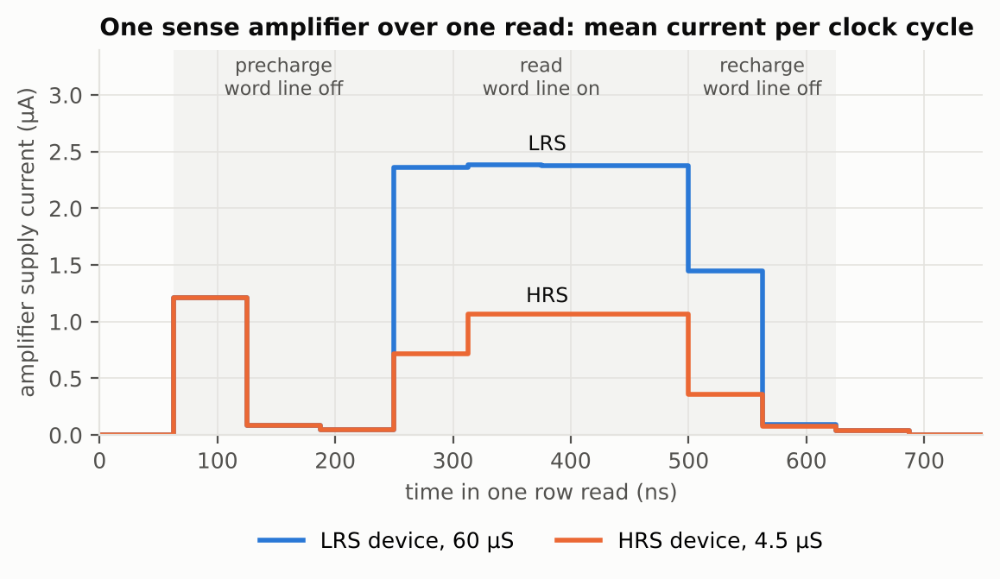
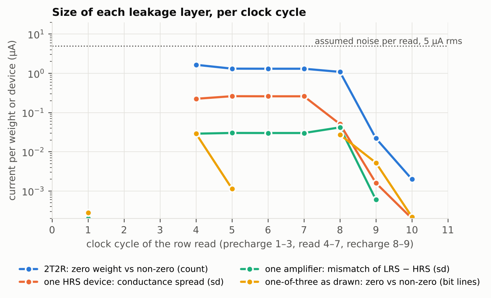
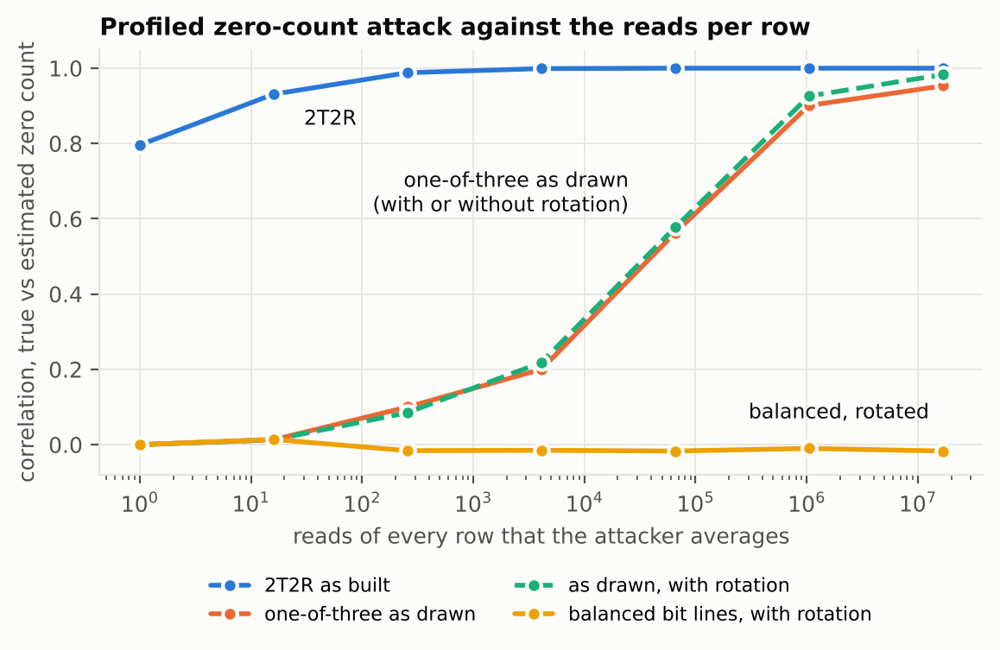

# One of Three Is Not Enough: Layered Supply-Current Leakage of a One-Hot Ternary ReRAM Cell for Compute-in-Memory

*Draft 1.0, 14 November 2026. Generated by `studies/paper-v1-2026-11-14/make_paper.py` from `results/security/v1/`. Every leakage
result is a statement about a model built from SPICE simulations of the drawn circuits. Nothing here is measured on silicon.
The device parameters are placeholders fitted to SkyWater's published data.*

## Abstract

A compute-in-memory accelerator keeps a network's weights in its memory array, so the array's supply current is a side channel
on the model. In the common 2T2R ternary code a zero weight has no low-resistance (LRS) device, and the read current counts the
zeros of a row. We study this leak, and the obvious fix, on TCIM0, an open 72 × 24 ternary ReRAM tile drawn on SKY130. The model
uses SPICE waveforms of the drawn sense amplifier in the order in which the tile's controller operates it, 400
mismatch samples, and the bit-line capacitances of the drawn layout. For 2T2R, an attacker who profiled other chips estimates
each row's zero count from a single read with a correlation of 0.80, and gets 99.2 % of the rows exactly right
from 4,096 reads per row. A one-of-three cell stores every weight as one LRS device among three, so the count is constant.
It is not enough. What the current still tells falls into three further layers: sense-amplifier mismatch times the position of
the LRS device, specific to one chip; bit-line capacitance asymmetry times that position, the same on every chip; and the
devices' own conductances. With the cell as drawn, the second of these returns the zero count to the profiling attacker: correlation
0.56 at 65,536 reads per row and 0.90 at 1,048,576. That is four to five orders of magnitude more reads than 2T2R needs, and still
about one minute of acquisition. Rotating the sense amplifiers at random removes the chip-specific layer and nothing else. With
bit lines of equal capacitance (for instance transposed along the column), the same attack finds nothing up to 16,777,216
reads per row, and a bound on the information per row is zero in the model once rotation is added. The cell costs 1.56× the
2T2R cell area, 1.53× the analog macro area and 1.50× the read charge at one third zero weights, and it turns every
single-device flip into a detectable invalid code.

## 1. Introduction

Ternary weights (−1, 0, +1) make a multiplication a sign selection, and trained ternary networks hold many zeros: about 42 % of
the weights of BitNet b1.58 [W1]. A digital accelerator that skips zeros leaks their positions through timing [F4, F5]. A
compute-in-memory (CIM) array that stores a zero as "no conducting device" leaks their number through its read current, also when
its logic does nothing that depends on the data [A4, A13].

The textbook answer is a constant-weight code: store every value with the same number of conducting devices. Dual-rail storage
does this for binary data in resistive memory [A8, C3, N1], and a cell with one low-resistance element among three has been
patented for ternary content-addressable memory, without a security purpose [P1]. The question of this paper is what such a
code is worth for the weights of a ternary CIM tile once the circuit around the cell is real: amplifiers that differ, bit lines
that differ, and a controller that precharges, reads and recharges.

Contributions:

1. A leakage model of an open, drawn ternary ReRAM CIM tile that follows the controller's read sequence, treats every sense
   amplifier as its own mismatch sample and includes the extracted bit-line capacitances (Sections 3 and 5).
2. A four-layer account of what the read current of a one-hot cell tells, with the size of each layer in this design, who can
   use it and what removes it (Section 4, Table 1).
3. Evidence that the count balance of a one-of-three cell is necessary and not sufficient: as drawn, the cell's bit-line
   asymmetry gives a profiling attacker the zero count back at about 10⁴ to 10⁵ times the reads; sense-amplifier rotation does
   not change that; equal bit-line capacitances do (Section 6).
4. The costs, and one gain that is not about security: every single-device flip becomes a detectable invalid code (Section 8).
5. An artifact: layouts, netlists, scripts and result files are in the repository; each number in this paper is read from a
   file by the generator.

What is not new, and is used here: the 2T2R ternary code [C1]; one LRS element among three as a ternary state [P1]; 1-of-n and
dual-rail codes against power analysis [D2, D4]; random swapping of two sense amplifiers to hide their mismatch [P2]; the fact
that capacitance imbalance limits dual-rail hiding, in logic [D3, D6, D7] and on the bit lines of a dual-rail memory [P3].

## 2. Threat model

The attacker:

- has physical access to a programmed device and measures its supply current;
- knows or chooses the inputs;
- owns other devices of the same design and programs them with known weights (profiling);
- can trigger margin checks. A margin check reads one chosen row and runs under LOCK, so row-aligned reads are available
  without limit.

The attacker does not read the tile's results; in a deployment they go to the host only. With readable results, 72 chosen input
vectors give the weights directly, which is model extraction through the prediction interface [T1] and outside any side-channel
defence. Revision 4.9 of the logic sets LOCK at reset, refuses read-back and programming under LOCK, and clears LOCK only by an
erase of the whole array, so the attacker cannot calibrate the victim's amplifiers by reprogramming a row. We still report a
"calibrated" attacker who knows every amplifier of the victim, as a worst case. Fault injection, localized electromagnetic
probing and attacks on the programming phase are out of scope (Section 9).

## 3. The tile and one read

TCIM0 is a 72 × 24 ternary tile presented to a host as a memory-mapped device. In digital mode it reads one row at a time: every
bit line of the row goes to its own current-mode sense amplifier, each device is read as one bit, and a counter per column adds or
subtracts. The test chip uses 2T2R cells on SKY130 with SkyWater's ReRAM layer; its layout passes ChipFoundry's shuttle precheck
(14 of 14 checks). The one-of-three variant is drawn and verified at block level (cell, array, analog macro, controller
option); it is not assembled into a chip.

The array controller reads a row in 13 clock cycles (16 MHz, shortest settings): the bit lines leave ground and are connected to
the amplifiers with the word line off (precharge, three cycles); the word line is on for four cycles and the outputs are sampled
in the last; the word line goes off with the bit lines still on the amplifiers for two cycles (recharge); then the lines are
released and grounded. Figure 1 shows the supply current of one amplifier, cycle by cycle, from SPICE of the drawn amplifier,
column switch, drivers and cell with a bit line of 145.5 fF (ChipFoundry's PDK models, typical corner, 27 °C).

*Figure 1. Supply current of one sense amplifier over one row read, mean per clock cycle (62.5 ns).*

Three facts in this figure matter for what follows.

- The precharge is the same for both states: the line charges to 0.364 V before any cell conducts (1.21 µA in that cycle).
- During the read an LRS device draws the clamped reference current (2.39 µA, almost independent of its conductance) and
  pulls its line down to 0.045 V; an HRS device draws 1.07 µA at 4.5 µS, in proportion to its conductance, and its line
  settles at 0.240 V.
- After the word line falls, both lines recharge, the LRS line from much lower: 1.45 µA against 0.36 µA in that cycle. This
  charge is the line's capacitance times its voltage swing, so it carries the capacitance of whichever line held the LRS device.

The draft of 8 November used waveforms that started with the word line on and the bit line discharged, which mixes precharge and
read. Its mismatch samples were also not paired: the simulator ignored the seed, so one "amplifier" was a different sample at
every conductance. Here the seed is set in the deck, and the script checks that one seed gives one amplifier (its precharge
current is the same for every cell to within 4 nA). All leakage numbers below are new, and that draft's position
numbers are withdrawn.

## 4. Four layers of leakage

Write the supply current of one row read as a sum over its bit lines. Each line contributes a current that depends on (a) the
state of its device, (b) the amplifier that reads it, (c) the line's own capacitance and its neighbors, and (d) the device's
conductance. Summed over a row, these give four layers (Table 1).

**Table 1. What the read current of a row tells, by layer.** Sizes are per weight or per device, in the cycle where each is
largest; the assumed measurement noise is 5 µA rms per cycle and read.

| Layer | Cause | Same on every chip? | Who can use it | Size in this design | Removed by |
|---|---|---|---|---|---|
| L1 count | the number of LRS devices in the row depends on the weights | yes | anyone who profiled another chip | 2T2R: 1.65 µA per zero weight; one-of-three: 0 | a constant-weight code (one-of-three) |
| L2 amplifier | each amplifier's mismatch, times which amplifier reads the LRS device | no | only who knows the victim's amplifiers | 27 nA sd per amplifier on an LRS read, 43 nA in the recharge | random rotation of the amplifiers; or keeping the attacker from calibrating |
| L3 bit line | each line's capacitance and coupling, times which line holds the LRS device | yes | anyone who profiled another chip | as drawn: +29 nA and -27 nA per zero weight (first read cycle, recharge); routing: 3.3 nA per fF of imbalance | equal capacitances of the three lines of a column; rotation at the array edge for the routing part |
| L4 device | each device's own conductance | no | nobody without the devices' values | 0.26 µA sd per HRS device | not needed; it acts as a fixed pattern that masks L2 and L3 |

L1 is the leak of the 2T2R code. A one-hot code removes it and nothing else. L2 was the "position residual" of the 8 November
draft. With 400 samples and the reference generator shared by all amplifiers, as on the chip, its spread
is 27 nA per amplifier on an LRS read. With the reference generator's own mismatch drawn per sample instead, as in the draft of 8 November, the spread is 0.120 µA (100 samples); that part is common to all amplifiers of a chip and carries no position information.

L3 is the new layer of this draft. In the drawn one-of-three cell the three bit lines of a column run side by side on metal 2
with the source line between the first two. Magic's extraction of the cell gives, over 72 rows, a capacitance to everything but
the neighbor lines of 15.5 fF (P), 10.7 fF (Z) and 14.7 fF (N), a coupling of 5.57 fF between neighbors in a column
and 7.01 fF from the N line to the P line of the next column. The Z line, in the middle, differs from the other two. In SPICE
of the coupled lines, a zero weight (LRS on Z) then draws +29.1 nA in the first read cycle and -27.4 nA in the recharge
cycle against a non-zero weight, averaged over the neighbors' states. This is about one fiftieth of the 2T2R signal, it has the
same sign on every chip, and it is tied to the zero weights. With three lines of equal capacitance the term is exactly zero in
SPICE. Routing between the array and the amplifiers adds a per-line term that does not favor Z: 0.86 nA per fF in the first
read cycle and 3.31 nA per fF in the recharge. For scale, the 2T2R macro's extracted lines hold 107 to 195 fF, and
the two lines of a column differ by +2.3 fF on average with a spread of 11.0 fF (-36.6 to +22.6 fF). The
3T3R macro's routing is not extracted.

L4 is large and harmless on its own: an HRS device's current follows its conductance, which is assumed lognormal (median
4.5 µS, σ_ln 0.3). It is a fixed pattern of one programmed chip that no attacker knows, and it does not average out.

*Figure 3. Size of each layer per clock cycle of the read. The layout term of the one-of-three cell sits near the amplifier
mismatch, about 50 times below the 2T2R count signal and more than 150 times below the assumed noise of one read.*

## 5. Model and method

- **Waveforms.** ngspice transients of the drawn circuits in the controller's sequence, averaged per clock cycle (12 samples per
  row read). One line: conductances from 0.31 to 120 µS, 400 local-mismatch samples, reference bias shared.
  Coupled lines of one column with both neighbor lines: every weight and neighbor state, with the drawn capacitances.
- **Tile.** Every amplifier of a chip is a different sample. A line's current is its amplifier's waveform at its device's
  conductance, plus the nominal layout correction for its line type, its own state and its two neighbors' states, plus its routing
  imbalance times the SPICE sensitivity. Conductances as in Section 4 (LRS lognormal, median 60 µS, σ_ln 0.35, 30 to 120 µS).
  Revision 4.7 accumulator model for the digital part (0.15 µA per flipped bit). Noise: 5 µA rms per cycle and read (assumption;
  the reads needed scale with its square).
- **Reads.** Row-aligned, as a margin check gives them. One row read takes 13 cycles, 812.5 ns; the array time of N reads
  of all 72 rows is 72 N × 812.5 ns, before the command overhead of the serial port.
- **Tests.** Welch t per sample, threshold 4.5, 150,000 traces per group, both groups reprogrammed for every trace (so a test
  sees weights, not one programmed instance). "Fixed vs random" compares one weight matrix with random matrices. "Fixed vs fixed,
  rows permuted" compares a matrix with a copy whose columns are permuted in every row: the zero count and sign counts of every
  row are equal, so only position can differ. First order (means) and second order (centered squares).
- **Attack.** A profiled zero-count attack. Profiling on 8 chips of the same design with known weights, read without noise;
  linear minimum-mean-square-error estimate from the 12 samples of a row averaged over N reads; 20 victim chips per point.
- **Bound.** For one row, a Gaussian-channel bound on the information between its 24 weights (38.0 bits) and its averaged
  current: signal covariance over random rows against measurement noise over N, the rotation's sampling noise over N, and the
  conductance fixed pattern. Two attackers: one who profiles other chips (the amplifiers' mismatch is one more fixed pattern), one
  who knows the victim's amplifiers. The bound is an upper limit under these assumptions; it is not a proof of security.

## 6. Results

### 6.1 The zero count

**Table 2. Profiled zero-count attack: correlation between true and estimated zero count per row (rows exactly right).**
Guessing the most likely count is right for about 17 to 18 % of rows.

| Reads per row | Array time | 2T2R as built | one-of-three as drawn | as drawn, rotation | balanced bit lines | balanced, rotation |
|---|---|---|---|---|---|---|
| 1 | 5.8e-05 s | 0.80 (30 %) | 0.00 (18 %) | 0.00 (18 %) | 0.00 (18 %) | 0.00 (18 %) |
| 16 | 0.00094 s | 0.93 (50 %) | 0.01 (18 %) | 0.01 (18 %) | 0.01 (18 %) | 0.01 (18 %) |
| 256 | 0.015 s | 0.99 (87 %) | 0.10 (18 %) | 0.09 (18 %) | -0.00 (18 %) | -0.02 (18 %) |
| 4,096 | 0.24 s | 1.00 (99 %) | 0.20 (18 %) | 0.22 (17 %) | -0.02 (18 %) | -0.01 (18 %) |
| 65,536 | 3.8 s | 1.00 (100 %) | 0.56 (20 %) | 0.58 (20 %) | -0.04 (18 %) | -0.02 (18 %) |
| 1,048,576 | 61 s | 1.00 (100 %) | 0.90 (34 %) | 0.93 (39 %) | -0.01 (17 %) | -0.01 (18 %) |
| 16,777,216 | 16 min | 1.00 (100 %) | 0.95 (48 %) | 0.98 (67 %) | -0.01 (18 %) | -0.02 (18 %) |

*Figure 2. The attack of Table 2 against the reads per row.*

- 2T2R leaks the count at once: correlation 0.80 from one read, 0.99 from 256.
- One-of-three as drawn is silent up to a few hundred reads and then is not: 0.20 at 4,096 reads, 0.56 at 65,536,
  0.90 at 1,048,576. The signal is the Z line's capacitance (L3). The cost of the attack rises by four to five orders of
  magnitude in reads, to about 61 s of array time.
- Rotation changes nothing here (0.93 at 1,048,576 reads): it permutes amplifiers, and the capacitance stays with the line.
- With equal bit-line capacitances the attack stays at the guessing rate up to 16,777,216 reads per row, with or without rotation.

### 6.2 Position

**Table 3. Row-aligned tests, max |t| over the 864 samples of a trace, 150,000 traces per group, one fixed matrix.**

| Design | Fixed vs random weights: first order | second order | Fixed vs fixed, rows permuted (position only): first order | second order |
|---|---|---|---|---|
| 2T2R as built | 529.55 (leaks) | 106.06 (leaks) | 39.53 (leaks) | 3.37 (passes) |
| one-of-three as drawn | 25.35 (leaks) | 4.68 (leaks) | 37.87 (leaks) | 3.14 (passes) |
| one-of-three as drawn, rotation | 23.84 (leaks) | 4.01 (passes) | 33.17 (leaks) | 3.95 (passes) |
| balanced bit lines, no rotation | not run | not run | 26.28 (leaks) | 3.14 (passes) |
| balanced bit lines, rotation | 4.79 (leaks) | 4.00 (passes) | 3.22 (passes) | 3.95 (passes) |

Over three further fixed matrices and chips at 50,000 traces per group, first order: one-of-three as drawn, position only,
18.75 to 22.51; with rotation 13.87 to 19.28; balanced with rotation, position only, 2.98 to 3.30, and fixed vs random
3.23 to 3.60. Growth of the first-order value with the traces per group, one-of-three as drawn, position only: 11.4 at 10,000, 14.9 at 20,000, 21.7 at 50,000, 31.6 at 100,000, 37.9 at 150,000.

Read by rows: as drawn, the cell fails the position-only test with and without rotation, because the bit-line term stays.
With balanced lines and no rotation it still fails (26.28): that is the amplifier term of this one chip. With balanced lines and
rotation the position-only test passes.

The balanced, rotated cell's fixed-vs-random value of 4.79 lies above the threshold. Its sample is clock cycle 10 of
a row read, where no amplifier draws current. A repeat with another matrix, chip and noise gives 2.97, and the three further
matrices stay below the threshold. We read it as a chance excursion among 864 samples and report it as it came out.

The 2T2R cell also fails the position-only test: its two lines differ in routing capacitance, so the read current tells the
sign of a weight as well as its presence.

### 6.3 How much, at most

**Table 4. Gaussian-channel bound on the information about one row's 24 weights (38.0 bits) in its averaged read
current, in bits.**

| Design | Attacker | 1 read | 10⁴ reads | 10⁶ reads | 10⁸ reads |
|---|---|---|---|---|---|
| 2T2R as built | profiles other chips | 0.71 | 5.08 | 6.84 | 9.01 |
| 2T2R as built | knows the victim's amplifiers | 0.71 | 5.72 | 8.30 | 12.68 |
| one-of-three as drawn | profiles other chips | 0.00 | 1.26 | 3.76 | 5.56 |
| one-of-three as drawn | knows the victim's amplifiers | 0.00 | 1.98 | 5.30 | 9.27 |
| as drawn, rotation | profiles other chips | 0.00 | 1.54 | 3.99 | 5.40 |
| as drawn, rotation | knows the victim's amplifiers | 0.00 | 1.67 | 4.59 | 7.15 |
| balanced bit lines, no rotation | profiles other chips | 0.00 | 0.00 | 0.00 | 0.00 |
| balanced bit lines, no rotation | knows the victim's amplifiers | 0.00 | 0.67 | 1.41 | 3.32 |
| balanced, rotation | profiles other chips | 0.00 | 0.00 | -0.00 | -0.00 |
| balanced, rotation | knows the victim's amplifiers | 0.00 | 0.00 | 0.00 | 0.00 |
| balanced array, routing imbalance 5.5 fF, rotation at the amplifier | profiles other chips | 0.00 | 0.19 | 0.68 | 1.63 |
| balanced array, routing imbalance 5.5 fF, rotation at the amplifier | knows the victim's amplifiers | 0.00 | 0.31 | 1.00 | 2.27 |
| the same, rotation at the array edge | profiles other chips | 0.00 | 0.00 | -0.00 | -0.00 |
| the same, rotation at the array edge | knows the victim's amplifiers | 0.00 | 0.00 | 0.00 | 0.00 |

- 2T2R gives away more than the count as the reads grow, because the 12 samples of a read are not proportional to each other.
- One-of-three as drawn stays below 0.2 bit per row up to 100 reads and reaches several bits per row with 10⁶ reads.
- With balanced lines and no rotation, only the calibrated attacker gains anything (L2): at most 1.4 bits per row from 10⁶
  reads. With rotation the bound is zero for both attackers: in the model, the rotation makes the distribution of every read's current the same for all weights.
- A routing imbalance of 5.5 fF per line, with rotation at the amplifier, leaves a design-wide position term. Rotation at the
  array edge moves the routing to the amplifier's side of the switch and removes it.

### 6.4 Sensitivity

- **Programmed states.** The drawn drivers program an LRS near 30 µS and, with one reset pulse, an HRS near 0.3 µS. With LRS
  uniform from 28.4 to 29.9 µS and HRS lognormal with median 0.6 µS (assumption), 2T2R leaks more (correlation 0.91 from one
  read), one-of-three as drawn about the same (0.87 at 1,048,576 reads) and the balanced, rotated cell nothing (-0.01 at
  16,777,216).
- **Trained weights.** On the first layer of a small ternary digits network (16.7 % zeros, three tiles), 2T2R gives 0.87 from one
  read, one-of-three as drawn 0.72 at 65,536 reads and 0.94 at 1,048,576, balanced and rotated +0.01 at 16,777,216.
- **Noise.** All read counts scale with the square of the assumed 5 µA.

## 7. Rotation and balance as circuits

**Rotation.** Each sense amplifier of a column gets three column switches instead of one, to the column's three bit lines, and a
random cyclic shift r per column and read selects one switch per amplifier; the logic shifts the three sense bits back. In SPICE
the 3 × 3 switch matrix reads every weight correctly for every r (all cases decode), draws the same total current for
every r in the nominal circuit, and costs 0.7 % more read charge from the extra switch junctions. Rotation needs log2(3) bits
per column and read, uniform: a shift taken as a 2-bit value modulo 3 has probabilities (1/2, 1/4, 1/4) and leaves a quarter of
the amplifier term. The tile's 16-bit LFSR cannot supply 24 independent shifts per read; a wider generator is needed, and its
state after reset is predictable like the LFSR's. Random swapping of two sense amplifiers for complementary memory arrays is
patented [P2]; path switching does the same for dual-rail logic [D7]. Rotation is not drawn and not in the RTL.

**Balance.** The array part of L3 disappears when the three lines of a column have equal capacitance to ground and equal
coupling to each other. Transposing the lines along the column (each line spends a third of the rows in each track, two
crossings per column) gives this by symmetry; a symmetric cell with a shield between columns would do the same. SPICE of the
transposed column gives identical currents for the three weights. Bit-line crossover against power analysis of dual-rail memory
is known, with the remark that it does not equalize capacitance to a fixed potential [P3]; a cyclic transposition of three lines
equalizes both. What transposition leaves is a term in pairs of neighboring columns, because a column's last track couples to the
next column's first; it is not simulated here, and a grounded shield between columns removes it. The routing part needs either
matched routing or rotation at the array edge, where the switches must be 5 V devices at the array's pitch. Neither layout is
drawn.

**Order of work.** Balance comes first. Rotation alone leaves the design-wide term in place (Table 2), and the design-wide term
is the one that a profiling attacker can use on any chip.

## 8. Cost and a second use

| | 2T2R | one-of-three |
|---|---|---|
| Cell (SKY130, drawn) | 3.6 × 3.0 µm | 5.6 × 3.0 µm (1.56×) |
| Analog macro | 1436.7 × 1391.7 µm | 1566.3 × 1950.5 µm (1.53×) |
| Sense amplifiers | 48 | 72 |
| Read charge per weight, published states | 1134 fC (±1), 716 fC (0) | 1492 fC |
| ratio at 0 / 33 / 50 / 70 % zeros | | 1.31× / 1.50× / 1.61× / 1.77× |
| ratio at the programmed states (30 / 0.31 µS) | | 1.13× / 1.50× / 1.80× / 2.35× |
| Single-device flips that give an invalid code | 2 of 6 | 9 of 9 |

A constant count means the worst-case charge on every read, so the penalty grows with sparsity. A current flattener on 2T2R
would hold the supply at the all-non-zero level, which is below the one-of-three level, but it needs a loop that is faster than
the read and its own tracking; it is the baseline to simulate next [A4].

The one-hot code is also an error-detecting code. If an LRS device loses its state with probability p_L and an HRS device sets
with probability p_H, independently, a 2T2R weight changes silently into another valid weight with probability 0.00013 at
p_L = p_H = 10⁻⁴, and a one-of-three weight with 2e-08; at p_L = 10⁻³ the figures are 0.00073 and 2e-07. The
price is more detected errors (0.0003 against 6.7e-05), each of which the logic flags (WERR) and counts as weight 0 until the
row is rewritten. Detection is not correction.

## 9. Limitations

- **Evidence.** Models only. The device parameters are placeholders; the noise level is an assumption; silicon is the decisive test.
- **Capacitances.** The array's are from Magic's extraction of the drawn cell, lumped per line; the 3T3R macro's routing is not
  extracted, so routing results are a sensitivity and an assumed spread. Bit-line resistance is not in the leakage decks.
- **Supply network.** The amplifiers' currents are summed; there is no shared supply network, package or probe model.
- **Corners.** Typical corner, 27 °C. The layout term depends on the line voltages, which move with corner and temperature.
- **Higher order.** Tests are of first and second order per sample; no multivariate or template attack on the position terms.
- **Not built.** Rotation and balanced bit lines are simulated at circuit level; neither is drawn or in the RTL. The 3T3R chip is
  not assembled.
- **Other channels.** Localized electromagnetic probing of the separate P, Z and N lines; the WERR flag as a fault oracle; the
  programming phase; the deterministic generator after reset; the sense register's switching between consecutive reads.

## 10. Related work

| | Work | What it does | Relation |
|---|---|---|---|
| A4 | Goudzwaard, MSc thesis, TU Delft, 2025 | power attack on a ReRAM CIM with ternary weights through its converters; current flattening and a memristive PUF as countermeasures | same target class; countermeasure at the periphery, not in the cell |
| A6 | Sapui and Tahoori, ASP-DAC 2024 | device mismatch as the leak source in memristive crossbars | our L2 and L4 |
| A8 | Sapui and Tahoori, ASP-DAC 2025 | collision attack on ReRAM CAM; dual-rail storage as countermeasure | constant LRS count for binary data |
| N1 | Yang, Degada and Thapliyal, arXiv 2609.33619, 2026 | balanced 4T-2MTJ cell with adiabatic sensing for MRAM; SPICE only | constant count for binary MRAM; no mismatch or layout layer |
| P1 | Best and Haukness (Rambus), US 9,704,576, 2017 | TCAM cell of three resistive elements, one of them low-resistance per ternary state | the one-of-three code itself, for another purpose |
| P2 | Chen et al. (TSMC), US 10,269,420 and family | complementary arrays read together; random swap of the two sense amplifiers | our rotation, for two amplifiers |
| P3 | Künemund (Infineon), US 7,161,869, 2007 | data-dependent capacitance sums on dual-rail bit lines; crossover | our L3, for dual-rail RAM |
| D2–D7 | WDDL, MDPL, 1-of-n logic, customized encodings, path switching | constant-weight hiding in logic and its limit by imbalance | the principle and its known weakness |
| C1, C3 | Laborieux et al.; Bocquet et al. | 2T2R ternary and binary differential ReRAM storage | the cells compared |
| E1 | Pai, Ankhdjet, arXiv 2608.26206, 2026 | open ternary compute-in-ROM on SKY130 | the nearest open ternary CIM design |

We found no study of a constant-weight cell for ternary CIM weights, and none that separates the amplifier, bit-line and device
layers for any resistive memory (web and patent search, 8 and 14 November 2026; IEEE Xplore not searched directly).

## 11. Conclusion

The 2T2R ternary code gives a row's zero count away in one read. A one-of-three cell removes the count and exposes what was
underneath it: the amplifiers, the bit lines and the devices. In this design the bit lines matter most, because their asymmetry
is the same on every chip and points at the zero weights; it returns the count to a profiling attacker at about a million reads
per row. Equal bit-line capacitances remove it, rotation of the amplifiers removes the chip-specific rest, and the order matters.
All of this is a model of a drawn design. The next chip should carry both cells, the balanced layout and the rotation, so that
each layer can be measured.

## Artifact

- SPICE decks and datasets: `chip/sky130/sim/seq_read.py`; `results/security/v1/seq_*.json`, `seq_mm_*.npz`.
- Tile model, tests, attack, bound: `tools/leak_v1.py`; experiment list `studies/paper-v1-2026-11-14/run_v1.py`.
- Figures and this text: `studies/paper-v1-2026-11-14/figures.py`, `make_paper.py`.
- Layouts: `layout/sky130/next_3t3r/`; logic option `TCIM_CELL_1OF3` in `rtl/tcim_core.sv`.

## References

To be checked against the publications before submission; IDs A–F as in `studies/paper-2026-11/LITERATURE.md`.

- [A4] J. J. C. Goudzwaard, "Analog CiM Security Analysis: Reverse-Engineering Ternary Neural Network Parameters," MSc thesis, TU Delft, 2025.
- [A6] B. Sapui, M. B. Tahoori, "Power Side-Channel Analysis and Mitigation for Neural Network Accelerators based on Memristive Crossbars," ASP-DAC 2024.
- [A8] B. Sapui, M. B. Tahoori, "Side-channel Collision Attacks on Hyper-Dimensional Computing Based on Emerging Resistive Memories," ASP-DAC 2025.
- [A13] C. Merkel, "Enhancing Adversarial Attacks on Single-Layer NVM Crossbar-Based Neural Networks with Power Consumption Information," arXiv 2207.02764, 2022.
- [C1] A. Laborieux et al., "Implementation of Ternary Weights With Resistive RAM Using a Single Sense Operation per Synapse," arXiv 2007.14234.
- [C3] M. Bocquet et al., "In-Memory and Error-Immune Differential RRAM Implementation of Binarized Deep Neural Networks," IEDM 2018.
- [D2] K. Tiri, I. Verbauwhede, "A Logic Level Design Methodology for a Secure DPA Resistant ASIC or FPGA Implementation," DATE 2004.
- [D3] T. Popp, S. Mangard, "Masked Dual-Rail Pre-Charge Logic," CHES 2005.
- [D4] S. Moore et al., "Balanced Self-Checking Asynchronous Logic for Smart Card Applications," Microprocessors and Microsystems, 2003.
- [D6] K. Tiri, I. Verbauwhede, "Prototype IC with WDDL and Differential Routing: DPA Resistance Assessment," CHES 2005.
- [D7] K. Baddam, M. Zwolinski, "Path Switching: A Technique to Tolerate Dual Rail Routing Imbalances," Design Automation for Embedded Systems, 2008.
- [E1] M. Pai, "Ankhdjet: An Open-Source Compiler for Mask-Programmed Ternary Compute-in-ROM on an Open PDK," arXiv 2608.26206, 2026.
- [F4] W. Hua, Z. Zhang, G. E. Suh, "Reverse Engineering Convolutional Neural Networks Through Side-channel Information Leaks," DAC 2018.
- [F5] S. Maji, U. Banerjee, A. P. Chandrakasan, "Leaky Nets," IEEE Internet of Things Journal, 2021.
- [N1] W. Yang, A. Degada, H. Thapliyal, "S-ALSA: Co-Design of Adiabatic Logic-based Sensing and Balanced Bit-Cells for Secure and Energy-Efficient MRAM," arXiv 2609.33619, 2026.
- [P1] S. C. Best, B. S. Haukness (Rambus Inc.), "Complementary RRAM applications for logic and ternary content addressable memory (TCAM)," US 9,704,576 B2, priority 28 February 2014, granted 11 July 2017.
- [P2] Y. Chen, S.-Y. Chou, C.-H. Chang, M.-S. Wu, Y.-D. Chih (TSMC), "Memory with symmetric read current profile and read method thereof," US 10,269,420 B2; continuation US 11,621,037 B2, granted 4 April 2023. Inventor list as printed on US 11,621,037.
- [P3] T. Künemund (Infineon Technologies AG), "Transmission device," US 7,161,869 B2, filed 23 December 2004, granted 9 January 2007.
- [T1] F. Tramèr et al., "Stealing Machine Learning Models via Prediction APIs," USENIX Security 2016.
- [W1] "Sparse-BitNet: 1.58-bit LLMs are Naturally Friendly to Semi-Structured Sparsity," arXiv 2603.05168, 2026 (zero fraction of BitNet b1.58 weights).
